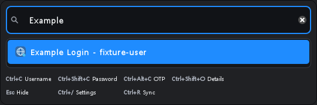
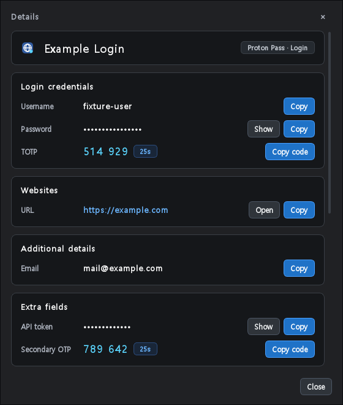
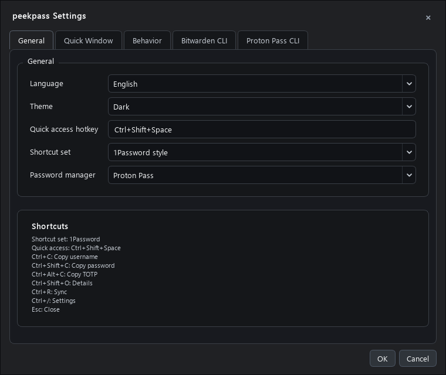
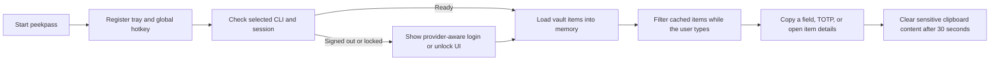

# peekpass

[](https://github.com/j0n9m1n1/peekpass/actions/workflows/ci.yml)
[](https://github.com/j0n9m1n1/peekpass/releases/latest)
[](LICENSE)

## References and Acknowledgements

peekpass was designed with reference to:

- [1Password Quick Access](https://support.1password.com/quick-access/) and [1Password keyboard shortcuts](https://support.1password.com/keyboard-shortcuts/)
- [Trikzon/quickwarden](https://github.com/Trikzon/quickwarden)
- [ixnas/Quickwarden](https://github.com/ixnas/Quickwarden)

peekpass is a small Qt Widgets desktop quick-access app for password-vault
items. It is inspired by 1Password Quick Access and delegates vault access to
the selected password-manager CLI instead of implementing vault encryption or
service APIs directly.

peekpass supports two password-manager backends:

- Bitwarden-compatible vaults, including Bitwarden US, Bitwarden EU, and
  self-hosted Vaultwarden servers through the Bitwarden CLI (`bw`).
- Proton Pass through the Proton Pass CLI (`pass-cli`).

This project is still early, Windows-first software.

## Features

- Global quick-access hotkey on Windows.
- Frameless always-on-top search window.
- Selectable Bitwarden or Proton Pass backend.
- First-run login screen that adapts to the selected password manager.
- Bitwarden CLI login and unlock flow.
- Proton Pass CLI (`pass-cli`) browser sign-in and existing-session connection.
- Startup preload so unlocked vault items are cached before the search window is opened.
- In-memory search over active item names, usernames, URIs, notes, and
  non-sensitive provider fields (trashed/deleted items are excluded).
- Fast keyboard actions for copying username, password, TOTP, and opening details.
- Independent, draggable item-details windows that leave quick access open.
- Provider-aware item details for Bitwarden and Proton Pass, including logins,
  secure notes, cards, identities, SSH keys, Wi-Fi, aliases, custom sections,
  show/hide secret toggles, live TOTP code and countdown timer, website open/copy
  actions, notes copy, and formatted provider metadata where available.
- Optional web favicon loading for search results.
- System tray menu with open, sync now, lock, settings, check for updates, and quit.
- Built-in update checker (via GitHub Releases) with SHA-256 verification,
  one-click in-app installer download and automatic restart, version skip,
  portable-mode notice, and optional startup update checks.
- Settings actions to log out of the selected password manager or reset local
  peekpass data and return to first-run state.
- Configurable hotkey, shortcut preset, quick window size, position, opacity, corner style, theme, font, language, result fields, result count, auto-sync interval, and focus-loss behavior.
- Optional Windows Credential Manager session storage for Bitwarden.
- Optional Windows startup registration without administrator rights.
- English and Korean UI with Qt Linguist translation files for adding more languages.

## Screenshots

| Login | Quick access |
| --- | --- |
|  |  |

| Search results | Item details | Settings |
| --- | --- | --- |
|  |  |  |

## Install and Run

- Windows 10 version 1809 or later / Windows 11
- One supported password-manager CLI:
  - Bitwarden CLI (`bw`)
  - Proton Pass CLI (`pass-cli`)

1. Download `peekpass-<version>-win64-setup.exe` from the
   [latest release](https://github.com/j0n9m1n1/peekpass/releases/latest).
2. Run the installer. It installs for the current user without administrator
   privileges and adds a Start menu shortcut and an uninstaller. Older releases
   and portable use can use `peekpass-<version>-win64.zip` instead: extract the
   complete archive and keep the Qt DLLs and deployment subdirectories together.
3. Install at least one supported password-manager CLI.
4. Launch peekpass from the Start menu, or run the portable `peekpass.exe`.
   A tray notification confirms that the app is running.
5. If no usable session exists, choose Bitwarden or Proton Pass in the login
   window and enter the fields shown for that provider.
6. Press `Ctrl+Shift+Space` to open quick access.

The password manager can later be changed in
**Settings > General > Password manager**.
The installer includes the Qt runtime; users do not need to install Qt.
Password-manager CLIs are installed separately. Windows startup remains opt-in
in the app settings. Uninstalling removes the startup entry but preserves app
settings and provider sessions; use **Reset peekpass** before uninstalling if
you want to sign out and clear those settings.
peekpass first looks for each CLI next to the application executable. Bitwarden
then falls back to `bw` on `PATH`. Proton Pass additionally checks its standard
Windows install location, `%LOCALAPPDATA%\Programs\ProtonPass\pass-cli.exe`,
before falling back to `pass-cli` on `PATH`. An explicit CLI location can also
be set in the corresponding settings tab.

- [Bitwarden CLI download and setup](https://bitwarden.com/help/cli/)
- [Proton Pass CLI installation](https://protonpass.github.io/pass-cli/get-started/installation/)

## Provider Behavior

| Behavior | Bitwarden / Vaultwarden | Proton Pass |
| --- | --- | --- |
| CLI | `bw` | `pass-cli` |
| Server selection | Bitwarden US, Bitwarden EU, or a custom URL | Managed by Proton Pass |
| Login inputs | Email, master password, optional 2FA method/code | Browser sign-in through the official CLI; no account password collected by peekpass |
| Locked session | Unlocks with `bw unlock --raw` | Log in again; dedicated lock-code unlock is not implemented |
| Tray lock action | Runs `bw lock` | Runs `pass-cli logout` |
| Session ownership | Optional session key storage in Windows Credential Manager | Owned by Proton Pass CLI |
| Sync | Runs Bitwarden sync and reloads items | Reloads the current item list; Proton Pass CLI has no separate sync command |

## How It Works



Vault encryption, account storage, and remote service access remain the
responsibility of the selected CLI. peekpass starts vault preparation when the
application starts so opening quick access normally does not have to wait for
the initial item load. If authentication is required, the login or unlock UI is
shown immediately instead.

## Project Structure

- `src/main.cpp` - Application startup, tray setup, and quick window wiring.
- `src/QuickWindow.*` - Quick-access search window, login/unlock UI, result
  list, copy actions, and favicon loading.
- `src/ItemDetailDialog.*` - Standalone item-details dialog with show/hide
  secret toggles, live TOTP countdown, website open/copy actions, notes copy,
  and provider-specific card sections.
- `src/TotpGenerator.*` - RFC 6238 TOTP code and countdown generator.
- `src/UpdateChecker.*` - GitHub Release update checker and one-click in-app
  installer download/update dialog.
- `src/BwClient.*` - Bitwarden CLI wrapper for status, login, unlock, sync,
  item retrieval, sensitive field lookup, and session handling.
- `src/ProtonPassClient.*` - Proton Pass CLI wrapper for status, login, vault
  listing, item retrieval, and TOTP lookup.
- `src/PasswordManager.*` - Selects the active backend and presents the common
  password-manager contract to the UI.
- `src/VaultTypes.h` - Backend-neutral vault item and detail data structures.
- `src/AppSettings.*` - Persistent settings for hotkeys, UI options, language,
  sync interval, result display, and session storage preferences.
- `src/SettingsDialog.*` - Settings dialog UI and validation.
- `src/SingleInstance.*` - Single-instance lock and window activation forwarding.
- `src/WinHotkey.*` - Windows global hotkey registration and validation.
- `src/I18n.*` and `src/TranslationCatalog.cpp` - Runtime text lookup and
  built-in translations.
- `src/icons/` and `src/peekpass.rc.in` - Embedded UI icons, Windows application
  icon (`peekpass.ico`), and executable version metadata resource.
- `translations/` - Qt translation source files and translation notes.
- `packaging/windows/peekpass.iss` - Inno Setup script for the per-user Windows installer.
- `tests/` - A fake Proton Pass CLI and client/UI integration tests using
  provider-compatible command and JSON fixtures.
- `docs/screenshots/` - Application screenshots shown in this README.
- `docs/PROTON_PASS_VALIDATION.md` - Credential-safe live-account smoke-test
  checklist.

## Build

Building from source requires CMake 3.22+, a C++17 compiler, and Qt 6.10 or a
compatible Qt 6 release with Widgets, Concurrent, Network, LinguistTools, and a
matching compiler toolchain. Install the selected password-manager CLI before
running the application.

```powershell
cmake -S . -B build -DCMAKE_BUILD_TYPE=Release -DCMAKE_PREFIX_PATH="C:\Qt\6.12.0\mingw_64"
cmake --build build --parallel
ctest --test-dir build --output-on-failure
```

If Qt is already discoverable by CMake, the `CMAKE_PREFIX_PATH` argument is not
needed. Multi-config generators can omit `CMAKE_BUILD_TYPE` and use
`cmake --build build --config Release` instead.

Tests are enabled by default. Release-only builds can configure with
`-DBUILD_TESTING=OFF`. The automated Proton Pass test does not contact Proton or
read a real vault; it runs `ProtonPassClient` against a fake CLI whose commands
and JSON fixtures follow the official `pass-cli` contract. Use
[`docs/PROTON_PASS_VALIDATION.md`](docs/PROTON_PASS_VALIDATION.md) for the final
live-account smoke test.

## GitHub Release Build

GitHub Actions builds a Windows release package when a version tag is pushed:

```powershell
git tag -a vX.Y.Z -m "peekpass vX.Y.Z"
git push origin main
git push origin vX.Y.Z
```

peekpass follows semantic versioning (`MAJOR.MINOR.PATCH`). Keep the version in
`project(peekpass VERSION ...)` in `CMakeLists.txt` aligned with the Git tag.

The workflow creates a `peekpass-<tag>-win64.zip` package with `peekpass.exe`,
Qt runtime DLLs from `windeployqt`, translations, `README.md`, and `LICENSE`, plus
a `peekpass-<version>-win64-setup.exe` installer built with Inno Setup 6.3 or later,
and `SHA256SUMS.txt` for in-app update verification. All files are attached to the
GitHub Release. It can also be run manually from
the Actions tab. To rebuild an existing tag after fixing the release workflow, run the
workflow from `main` and enter that tag in the `release_tag` input. Leave
`release_tag` empty for a build-only manual run. Use a new version tag for each
source release.

To package a local Release build with its Qt runtime and translations, run:

```powershell
.\packaging\windows\package.ps1 -QtDir C:\Qt\6.12.0\mingw_64
```

This creates `dist/peekpass-0.3.9-win64-setup.exe`, the portable ZIP, and
`dist/SHA256SUMS.txt`. The script discovers Inno Setup 6 or 7 in system and
per-user installation directories; `-IsccPath` overrides it.

To invoke Inno Setup directly, first assemble a Release deployment folder with
`windeployqt` and copy the app translations, `README.md`, and `LICENSE` into it.
Then run Inno Setup 6.3 or later, using absolute paths for the deployment and
output directories (adjust the version to match `CMakeLists.txt`):

```powershell
& "${env:ProgramFiles(x86)}\Inno Setup 6\ISCC.exe" `
  "/DAppVersion=0.3.9" `
  "/DStageDir=$PWD\dist\peekpass-v0.3.9-win64" `
  "/DInstallerOutputDir=$PWD\dist" `
  ".\packaging\windows\peekpass.iss"
```

MSIX is also possible for this Qt desktop app, but needs a package manifest,
trusted package signing (or Store signing), and a packaged-app startup task in
place of the current registry-based startup registration. The current release
workflow produces the portable ZIP and Inno Setup installer.

The latest published package is available on the
[Releases page](https://github.com/j0n9m1n1/peekpass/releases).

## Usage

Default quick-access hotkey:

```text
Ctrl+Shift+Space
```

1Password-style shortcut preset:

```text
Ctrl+C          Copy username or primary field
Ctrl+Shift+C    Copy password
Ctrl+Alt+C      Copy TOTP
Ctrl+Shift+O    Open item details
Ctrl+R          Sync vault
Ctrl+/          Open settings
Esc             Close
```

Bitwarden-style shortcut preset:

```text
Ctrl+Enter      Copy username
Enter           Copy password
Alt+T           Copy TOTP
Ctrl+Shift+O    Open item details
Ctrl+R          Sync vault
Ctrl+/          Open settings
Esc             Close
```

The tray menu provides quick access (**Open**), **Sync now**, **Lock / Log out**,
**Settings**, **Check for updates...**, and **Quit** actions, while the tray tooltip
shows the current version and active backend. Copy actions can optionally display a
brief confirmation notification (configurable under **Settings > Behavior**).
On Windows, **Start with Windows** reflects the actual per-user `Run` registry
entry. peekpass verifies the write immediately and only enables it when the
executable is deployed with its required Qt platform and compiler runtime files;
a bare development-build executable is intentionally rejected.
To return to a completely fresh first-run state, use
**Settings > Behavior > Reset peekpass**. This signs out installed provider
CLIs, removes local settings and the stored Bitwarden session, unregisters
Windows startup, and closes the app.

## Security Notes

- Password-manager account passwords are never stored by peekpass.
- peekpass uses `bw login` and `bw unlock --raw` to obtain a Bitwarden CLI
  session.
- Vault item fields needed for quick search and copy are cached in memory while
  the app is running.
- In-memory vault data is cleared when the vault is locked or the app exits.
- Quick access reopens immediately from its in-memory cache, including during
  background refreshes. By default, copy and detail actions run immediately from
  the cache and verify the CLI session in the background right afterward (in
  addition to periodic 15-second background checks); you can enable **Verify CLI
  session before every copy (strict)** under **Settings > Behavior** to wait for
  a live CLI check before every copy. Failed checks or refreshes discard cached
  data, close detail windows, and clear owned clipboard content.
- Passwords and TOTP codes copied to the clipboard are cleared after 30 seconds if
  peekpass still owns the same clipboard content.
- Sensitive clipboard entries opt out of Windows clipboard history and cloud sync.
- TOTP secrets and passwords are not written to peekpass settings.
- Optional Windows Credential Manager storage persists the Bitwarden CLI session
  key, not the master password.
- Logging out runs `bw logout`, clears in-memory vault data, and removes the
  stored peekpass session.
- Proton Pass login opens `pass-cli login` in an interactive CLI window. Follow
  its browser link, complete authentication, then click **Check connection**.
  Accounts with extra passwords enter them directly into the CLI. Proton Pass CLI
  owns its own local session; peekpass does not copy that session into Windows
  Credential Manager.
- peekpass does not collect Proton account passwords or create credential files.
  Inherited Proton credential and personal-access-token variables are removed
  from child processes.
- Item details use provider-specific field sections so Bitwarden and Proton Pass
  item schemas are not forced into the same display model.
- Until a dedicated Proton Pass CLI lock-code UI exists, the tray action for
  Proton Pass safely runs `pass-cli logout` instead of `session lock`.
- Web favicon loading is optional. When enabled, peekpass requests
  `/favicon.ico` directly from websites stored in matching vault items, which
  exposes those hostnames to the corresponding web servers.

## Localization

English and Korean are currently supported. User-visible text is routed through
the Qt translation layer, and the selected language can also apply a suitable
default quick-access font and size.

To contribute another language, add `translations/peekpass_<locale>.ts`, list it
in `PEEKPASS_TRANSLATIONS` in `CMakeLists.txt`, and build it with Qt Linguist.
See [translations/README.md](translations/README.md) for the exact steps.

## Current Limitations

- Windows is the primary target.
- macOS/Linux global hotkey support is not implemented yet.
- Multi-account support is not implemented yet.
- The app depends on the selected Bitwarden or Proton Pass CLI being installed.
- Vault items are cached in memory for fast searching.
- YubiKey, passkey, and other hardware security key authentication flows have
  not been tested yet.
- Proton Pass command construction and JSON parsing are covered by a fake-CLI
  integration test, and full multi-item-type live verification can be tracked
  with [`docs/PROTON_PASS_VALIDATION.md`](docs/PROTON_PASS_VALIDATION.md).

## Status

This is a personal prototype and should be treated as preview software.

## License

peekpass application source code is licensed under the MIT License. See
[LICENSE](LICENSE).

peekpass currently links against Qt Widgets, Qt Concurrent, and Qt Network.
Qt is not relicensed by this project. When distributing Windows builds made with
open-source Qt, peekpass should use Qt as dynamically linked DLLs and include
the notices, license texts, and source-code access or written offer required by
the applicable Qt/LGPL terms. Users must be able to replace the Qt DLLs with
compatible versions.

This project does not currently use Qt modules that Qt documents as GPL-only.
If that changes, or if Qt is statically linked, the distribution requirements may
change significantly.

Proton Pass CLI is a separate GPL-3.0-or-later program. peekpass invokes a
user-installed `pass-cli` executable and does not copy, link, bundle, or derive
code from its source. peekpass itself remains MIT-licensed.

This is not legal advice.
